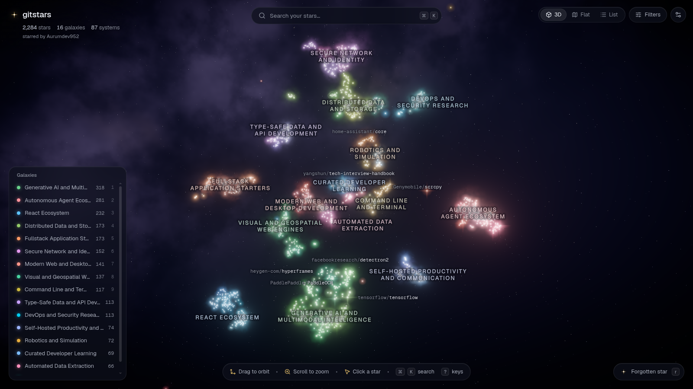

# gitstars

A 3D map of everything you have starred on GitHub.

An offline pipeline reads each starred repo, writes a short summary of it with an LLM, embeds the
summaries, and groups related repos into galaxies and systems. A web app renders that space as an
explorable galaxy with semantic search, so you can find the thing you starred last spring without
remembering its name.



## What you can do

- **Fly around your stars.** Each star is a repo. Its size follows the repo's star count and its
  brightness follows how recently you starred it. Galaxies are broad areas such as "Autonomous Agent
  Ecosystem", and systems inside them are narrower groups such as "Persistent AI Agent Memory".
- **Open a repo.** Click a star for its summary, kind, stack, tags, when you starred it, and its
  nearest neighbours in meaning.
- **Search by meaning.** Press ⌘K and type "self-hosted alternative to notion" or "run llms
  locally". Keyword and semantic results are merged, and the semantic model runs in the browser.
- **Light up a concept.** The lens recolours every star by how close it is to a phrase.
- **Filter.** Narrow by kind, language, tags, star count, last push, archived state or the month you
  starred it.
- **Replay your history.** The timeline plays back your stars month by month.
- **Switch views.** A 3D galaxy, a flat map and a sortable list share the same filters and search.
- **Rediscover.** "Forgotten star" picks a well-summarized repo you starred long ago that is still
  maintained.

Press `?` in the app for keyboard shortcuts.

## How it works

```
GitHub stars ─► fetch ─► card ─► gate ─► summarize ─► embed ─► layout ─► name ─► reassign ─► export
                                                                                               │
                                                                web/public/data/galaxy.json ◄──┘
```

1. **Fetch.** The GitHub GraphQL API lists your stars and their metadata. The pipeline then reads a
   small set of files per repo (README, manifests, `docs/` index, `AGENTS.md`, homepage text) and
   a depth-2 file tree. Repos you own are left out.
2. **Card.** Those sources are cleaned (no badges, HTML or boilerplate sections) and packed into a
   card of at most about 1,800 tokens.
3. **Gate.** `perplexity/pplx-decider-v1.2` drops sources that are generic boilerplate and rates the
   README's quality, which decides how much of it the card keeps.
4. **Summarize.** An LLM fills a fixed template: a one-liner, a summary, kind, domain, tags, stack
   and highlights. Free OpenRouter models are used first, ranked by size and recency and rotated
   under their rate limits. A local Gemma 4 server on vLLM takes over when the daily free quota runs
   out. The decider judges every summary, and a weak one is rewritten by another model.
5. **Embed.** `google/embeddinggemma-2` embeds the summaries on the GPU.
6. **Layout.** UMAP and HDBSCAN find systems in the mean-centred embedding space, and Ward
   clustering groups systems into galaxies. A supervised UMAP then places galaxies apart in 3D and 2D.
7. **Name and reassign.** An LLM names each system and galaxy. The decider checks every repo against
   its system and the four nearest alternatives, and moves it when another fits clearly better.
   Repos with no good home stay flagged as loosely placed.
8. **Export.** The result is written to `web/public/data/` and validated against
   `contract/galaxy.schema.json`, the format the pipeline and app share.

Every stage is cached by what it reads, so a rerun only touches new or changed repos.

## Requirements

- [bun](https://bun.sh) 1.4 or newer for the web app.
- Python 3.12 and [uv](https://docs.astral.sh/uv/) for the pipeline.
- The [GitHub CLI](https://cli.github.com), logged in (`gh auth login`).
- An NVIDIA GPU with a CUDA 13 driver for embeddings. Torch is pulled from the cu130 index.
- An [OpenRouter](https://openrouter.ai) key in `OPENROUTER_API_KEY`. The free models need no
  credit, but the decider costs a few cents per full run.
- Optional: Docker with the NVIDIA runtime and about 24 GB of VRAM for local summarization.

## Build your map

```bash
cd pipeline
uv sync
uv run gs fetch && uv run gs homepage && uv run gs card && uv run gs gate
uv run gs summarize                  # free OpenRouter models until the daily quota guard stops
```

To summarize the rest locally, start the vLLM server, then free the GPU again before embedding:

```bash
docker compose -f ../infra/vllm/compose.yaml up -d
uv run gs summarize --provider local
docker compose -f ../infra/vllm/compose.yaml down
```

Then lay out, name and export:

```bash
uv run gs embed && uv run gs layout
uv run gs name --provider local      # needs the vLLM server; use the default provider otherwise
uv run gs reassign && uv run gs name --provider local
uv run gs export
```

`uv run gs status` shows progress per stage and the quota left. `uv run gs show owner/name` prints
one repo's card, verdicts and summary, and `uv run gs report` lists every galaxy and system. See
`pipeline/README.md` for every command, and `infra/vllm/README.md` for the vLLM settings and the
log lines to check on startup.

## Run the app

```bash
cd web
bun install
bun run models:fetch   # optional: vendor the search model so search works offline
bun run dev            # http://localhost:3000
```

Without an export the app explains how to make one. `?data=fixture` loads a bundled 300-repo
sample. A static host needs the same headers the dev server sets, `Cross-Origin-Opener-Policy:
same-origin` and `Cross-Origin-Embedder-Policy: credentialless`, for in-browser search.

## Tests

```bash
cd pipeline && uv run pytest
cd web && bun run test && bun run typecheck && bun run build
```

## Repository layout

| Path | What it holds |
|---|---|
| `pipeline/` | The Python pipeline and the `gs` CLI |
| `web/` | The TanStack Start app, React Three Fiber scene, shaders and search worker |
| `infra/vllm/` | Docker Compose config and smoke test for local Gemma 4 |
| `contract/` | The JSON Schema for the export |
| `docs/` | The UI design spec and implementation notes for the web app |

Your data stays local. The SQLite database in `data/` and the export in `web/public/data/` are
gitignored.
